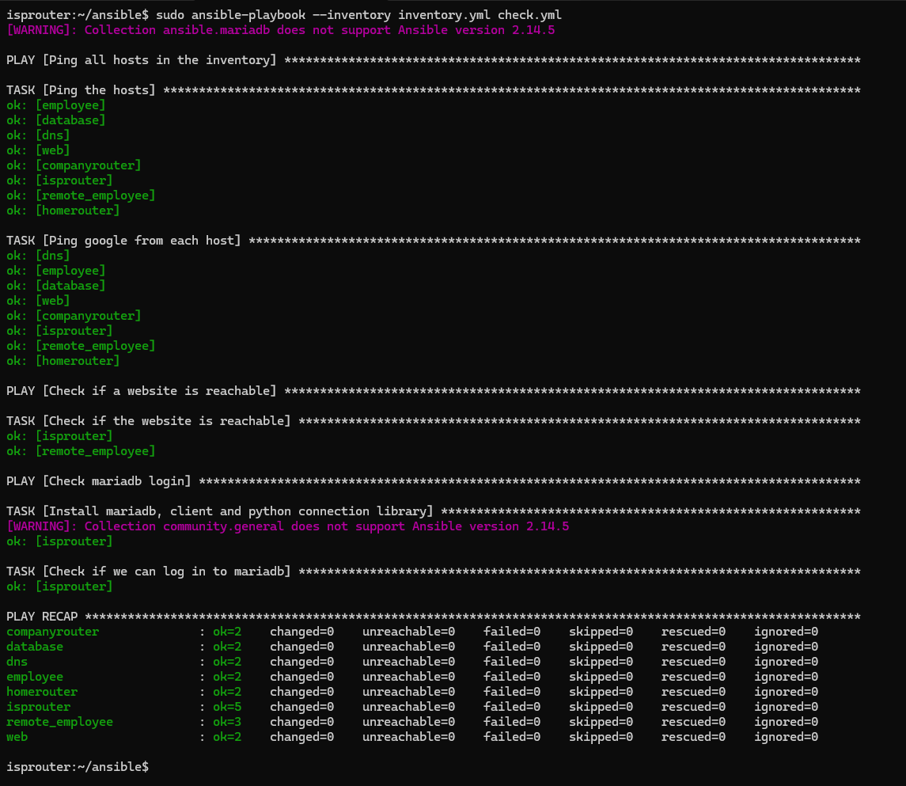
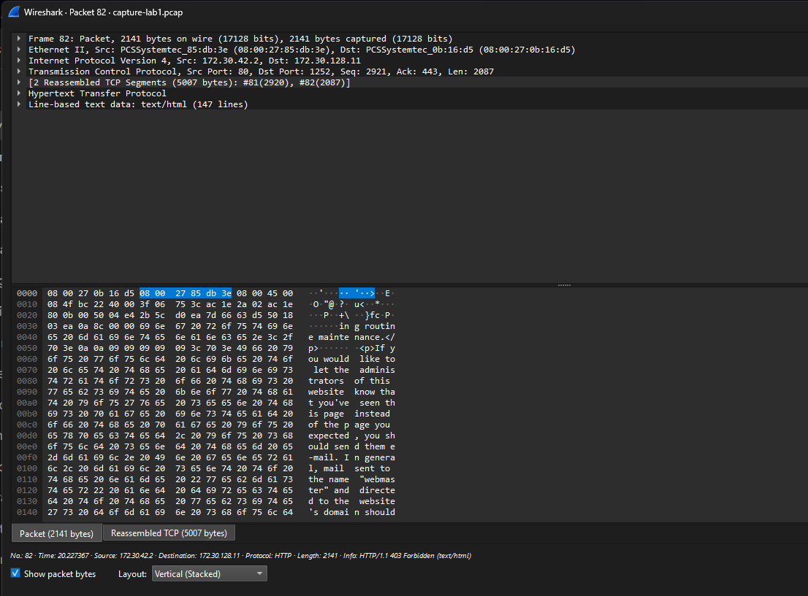
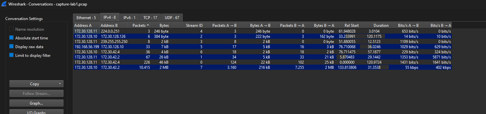
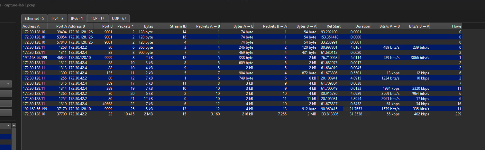
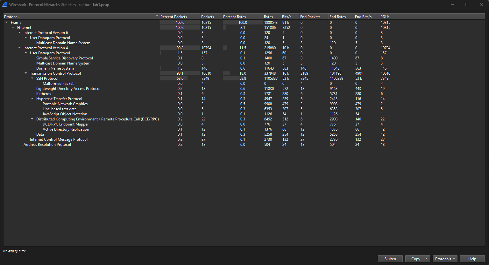
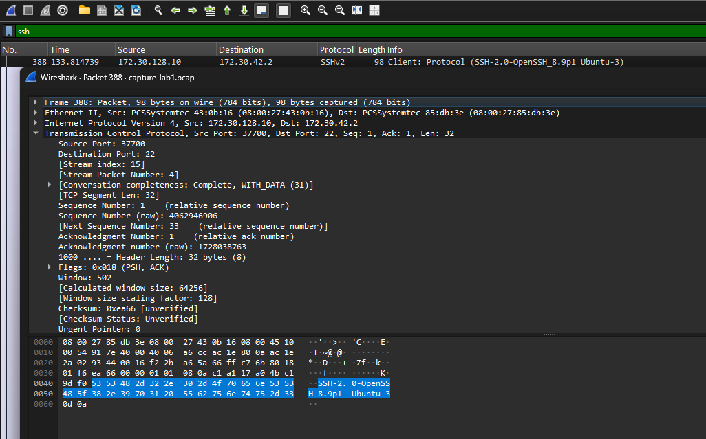
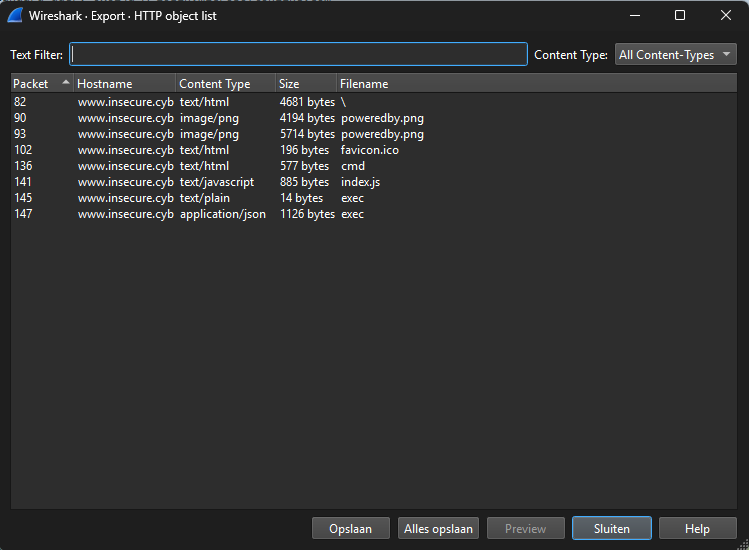
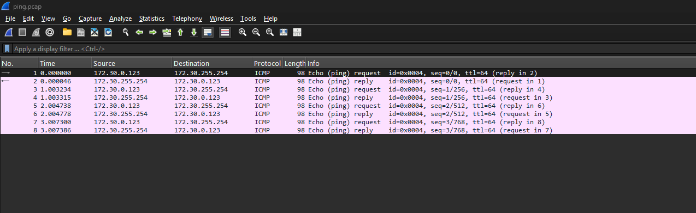
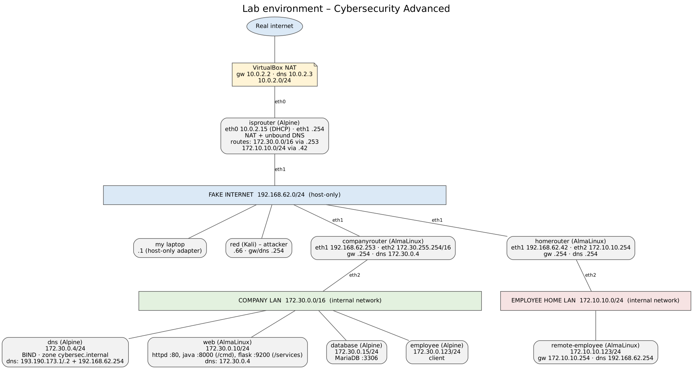

# Lab 1 – DNS

## 0. Setup

* Ran `run-on-isprouter.sh` (Ansible) on isprouter; `check.yml` OK for all hosts.

  

* Snapshot `basis-template` of all VMs (insecure starting state).
* red: NAT adapter disconnected (`VBoxManage modifyvm red --cable-connected1 off`), so red gets internet via isprouter.

---

## 2. Recap DNS: basic queries

### a) nslookup

```
> nslookup www.ugent.be
Server:  asse02.dnsresv6.prd.telenet-ops.be
Address:  2a02:1800:100::41:2
Non-authoritative answer:
Name:    www.ugent.be
Address:  157.193.43.50
```

* **Name + IP of the default DNS server?**
  * `asse02.dnsresv6.prd.telenet-ops.be` (`2a02:1800:100::41:2`) – the Telenet resolver, received automatically via my home router.
* **Name + IP of the requested URL?**
  * `www.ugent.be` → `157.193.43.50`.
* **What does "Non-authoritative answer" mean?**
  * The answer comes from a recursive resolver (possibly from cache), not from the authoritative nameserver of ugent.be.
* **Querying a specific DNS server** (`nslookup www.ugent.be 1.1.1.1` / `8.8.8.8`):
  * Same IP → no CDN/geo-DNS for this name.

### b) host and dig (on isprouter, `apk add bind-tools`)

```bash
isprouter:~$ host www.ugent.be
www.ugent.be has address 157.193.43.50

isprouter:~$ dig www.ugent.be
;; flags: qr rd ra; QUERY: 1, ANSWER: 1
www.ugent.be.           65      IN      A       157.193.43.50
;; SERVER: 195.130.131.1#53(195.130.131.1) (UDP)
```

* **Difference between host and dig?**
  * `host` = short output, `dig` = detailed output (flags, sections, TTL, server).
* **Authoritative nameservers** (`dig +short NS ugent.be`):
  * `ns1.ugent.be`, `ns2.ugent.be`, `ns1/ns2/ns3.belnet.be` (own servers + Belnet, redundancy).

```bash
isprouter:~$ dig www.ugent.be @ns1.ugent.be
;; flags: qr aa rd
;; WARNING: recursion requested but not available
www.ugent.be.           600     IN      A       157.193.43.50
```

* **What is an authoritative answer?**
  * Asking the source server directly → `aa` flag and the original TTL (600 instead of 65 from cache). No recursion (not an open resolver = good practice).
* **Reverse lookup** (`dig -x 157.193.43.50`):
  * `50.43.193.157.in-addr.arpa. PTR portlvs.ugent.be.` – the IP is looked up reversed under `in-addr.arpa`. The PTR does not have to match the forward name (here a load balancer).

### c) Zone transfer

* **What is it?**
  * An AXFR (over TCP) copies the full zone from a primary to a secondary DNS server. If anyone may request it, an attacker gets all hostnames and IPs at once (reconnaissance).
* **Test on the intentionally vulnerable `zonetransfer.me`:**

```bash
isprouter:~$ dig axfr zonetransfer.me @nsztm1.digi.ninja
internal.zonetransfer.me. 300   IN      NS      intns1.zonetransfer.me.
office.zonetransfer.me. 7200    IN      A       4.23.39.254
owa.zonetransfer.me.    7200    IN      A       207.46.197.32
vpn.zonetransfer.me.    4000    IN      A       174.36.59.154
contact.zonetransfer.me. 2592000 IN     TXT     "Remember to call or email Pippa on +44 123 4567890 ..."
...
;; XFR size: 53 records
```

---

## 3. Recap Wireshark (`capture-lab1.pcap`)

### Which OSI layers are captured?

* L2 (Ethernet, ARP), L3 (IP, ICMP), L4 (TCP, UDP), L7 (HTTP, DNS, SSH, Kerberos, LDAP, DCE/RPC).
* MAC prefix `08:00:27` = VirtualBox VMs.



### What do you notice in the conversations? (Statistics → Conversations)




* One SSH conversation (`172.30.128.10 → 172.30.42.2:22`) = ±96% of all packets (≈2 MB).
* `192.168.56.199` (other network) → `172.30.128.10:9999`: non-standard port, suspicious.
* `172.30.128.10 → 172.30.128.126:9001` every 60 s, always refused (RST): looks like a beacon/reverse shell.
* `172.30.42.4` uses ports 88, 135, 389 → Windows domain controller.

### Which protocols are most interesting? (Protocol Hierarchy)



* SSH (68% of packets, encrypted), HTTP (cleartext), "Data" (raw TCP on port 9999, unknown protocol), Kerberos/LDAP/AD replication.

### SSH session: which machines, who is server/client, which ports, TCP or UDP?



* Client `172.30.128.10:37700` → server `172.30.42.2:22`, **TCP**.
* The server listens on port 22 and receives the first SYN. The version banner (`SSH-2.0-OpenSSH_8.9p1`) is sent in cleartext.

### Cleartext data: what happened?

**Finding 1** – Follow TCP Stream on `tcp.port == 9999`: `192.168.56.199` has a **root shell** on `172.30.128.10` (Kali "red") without authentication (bind shell) and does reconnaissance:

```
whoami    → root
uname -a  → Linux red 5.18.0-kali5-amd64 ...
cat /etc/passwd
root:x:0:0:root:/root:/usr/bin/zsh
...
```

**Finding 2** – Follow HTTP Stream on `POST /exec`: the Windows client `172.30.128.11` uses the page "Command Injection" (`/cmd`) on `www.insecure.cyb` to run a command on the web server:

```
POST /exec HTTP/1.1
{"cmd":"ip a"}
HTTP/1.1 200 OK
Server: Apache/2.4.51 (AlmaLinux) OpenSSL/3.0.1
{"output":"... inet 10.0.2.15/24 ... inet 172.30.42.2/26 ..."}
```

### PNG: can you export it easily?

* **Export Objects → HTTP** only shows HTTP objects (the Apache `poweredby.png` logos, `/cmd`, `index.js`, `/exec`). The PNG we look for is **not** there.

  

* The PNG was sent over raw TCP (port 9999, stream 12, netcat-style). Export: Follow TCP Stream → Show as **Raw** → Save as `.png`. Result: HOGENT logo.


  

---

## 4. Capture traffic using the CLI (tcpdump)

Access to internal hosts via companyrouter as jump host: `ssh -J vagrant@192.168.62.253 vagrant@172.30.0.123`. tcpdump was already installed.

### IP configuration

```
companyrouter:  eth1 192.168.62.253/24 · eth2 172.30.255.254/16 · default via 192.168.62.254
dns:            eth1 172.30.0.4/24      · default via 172.30.255.254 onlink
employee:       eth1 172.30.0.123/24    · default via 172.30.255.254 onlink
```

### Which interface on companyrouter?

* **dns → internet:** `eth1` (traffic enters on eth2 and leaves on eth1).
* **dns → employee:** **none**. Same subnet, so the traffic goes directly via the switch and never passes companyrouter.

### Do you see all pings on companyrouter? (`sudo tcpdump -i eth2 -n icmp`)

* Ping employee → companyrouter: **visible**.
* Ping employee → dns: **not visible** (same subnet).

```
13:58:17 IP 172.30.0.123 > 172.30.255.254: ICMP echo request
13:58:17 IP 172.30.255.254 > 172.30.0.123: ICMP echo reply
```

### Capture to a file + analyse on the host

```bash
companyrouter:~$ sudo tcpdump -i eth2 -n -w /tmp/ping.pcap icmp
companyrouter:~$ sudo chmod 644 /tmp/ping.pcap
PS> scp vagrant@192.168.62.253:/tmp/ping.pcap $HOME\Downloads\ping.pcap
```



### How do you filter out SSH traffic?

* `sudo tcpdump -i eth2 -n not port 22` → 46 packets without filter, 12 with filter (only NTP and ARP left).

### Only HTTP to and from the web server

`sudo tcpdump -i eth2 -n host 172.30.0.10 and tcp port 80`

* **From isprouter:** traffic **visible** (routed through companyrouter).

```bash
isprouter:~$ curl --resolve www.cybersec.internal:80:172.30.0.10 http://www.cybersec.internal
...<h1>Welcome to the cybersec webserver!</h1>...

14:07:13 IP 192.168.62.254.51826 > 172.30.0.10.http: Flags [S]
14:07:13 IP 192.168.62.254.51826 > 172.30.0.10.http: HTTP: GET / HTTP/1.1
14:07:14 IP 172.30.0.10.http > 192.168.62.254.51826: HTTP: HTTP/1.1 200 OK
```

* **From employee:** the page loads, but **nothing is visible** in tcpdump. employee and web are in the same subnet, so the traffic does not pass companyrouter.

### Does the site use HTTP?

* Yes, everything is readable in cleartext. To be fixed in lab 6 (HTTPS).

---

## 6. Understanding the network + attacker machine red

### Configuring red

Kali VM, 1 active interface (`eth1`) on the host-only network (fake internet), with a static NetworkManager profile:

```bash
sudo nmcli con add type ethernet ifname eth1 con-name fake-internet \
  ipv4.method manual ipv4.addresses 192.168.62.66/24 \
  ipv4.gateway 192.168.62.254 ipv4.dns 192.168.62.254 \
  ipv6.method disabled autoconnect yes
sudo nmcli con up fake-internet
sudo systemctl enable --now ssh
```

* **What did you have to configure to have internet and ping web?**
  * A static IP in the fake internet (`192.168.62.66/24`), gateway isprouter (`192.168.62.254`, which does NAT and has the route to `172.30.0.0/16` via companyrouter), DNS isprouter.
* **Does ping work on IP only or also on hostname?**
  * On IP and on the full name `www.cybersec.internal`. `web` does not work: the zone only has records for `www` and `dns`, and red has no search domain.

```
└─$ ping -c2 8.8.8.8                → 0% loss
└─$ ping -c2 google.com             → 0% loss
└─$ ping -c2 172.30.0.10            → 0% loss
└─$ ping -c2 www.cybersec.internal  → 0% loss (172.30.0.10)
└─$ ping -c2 web                    → No address associated with hostname
```

### Network documentation



Collected with Ansible on isprouter (`ansible all -m shell -a 'ip -4 -o a; ip r | grep default; grep nameserver /etc/resolv.conf'`):

| Machine | IP | Default gateway | DNS | Static/DHCP |
|---|---|---|---|---|
| isprouter | 10.0.2.15 (eth0), 192.168.62.254 (eth1) | 10.0.2.2 | 195.130.131.1/.130.1 | eth0 DHCP, eth1 static |
| companyrouter | 192.168.62.253, 172.30.255.254/16 | 192.168.62.254 | 172.30.0.4 | static |
| dns | 172.30.0.4/24 | 172.30.255.254 | 193.190.173.1/.2 + 192.168.62.254 | static |
| web | 172.30.0.10/24 | 172.30.255.254 | 172.30.0.4 | static |
| database | 172.30.0.15/24 | 172.30.255.254 | 193.190.173.1/.2 + 172.30.0.4 | static |
| employee | 172.30.0.123/24 | 172.30.255.254 | 193.190.173.1/.2 + 172.30.0.4 | static |
| homerouter | 192.168.62.42, 172.10.10.254 | 192.168.62.254 | 192.168.62.254 | static |
| remote-employee | 172.10.10.123/24 | 172.10.10.254 | 192.168.62.254 | static |
| red | 192.168.62.66/24 | 192.168.62.254 | 192.168.62.254 | static |
| my laptop | 192.168.62.1/24 (host-only) | – | – | static |

* **Which machines have a static IP, which use DHCP?**
  * All static, except the NAT interface of isprouter.
* **How many actual networks?**
  * 4: company LAN (172.30.0.0/16), fake internet (192.168.62.0/24), employee home LAN (172.10.10.0/24), VirtualBox NAT (10.0.2.0/24).
* **Which static routes, where, and how to make them persistent?**
  * Only **isprouter** needs real static routes: `172.30.0.0/16 via 192.168.62.253` (companyrouter) and `172.10.10.0/24 via 192.168.62.42` (homerouter). The rest works with the default gateway.
  * Persistent: on Alpine via `up ip route add ...` in `/etc/network/interfaces`; on AlmaLinux/Kali via `nmcli con mod <conn> +ipv4.routes "<net> <gw>"`.
* **Purpose of each machine (essential processes):**
  * **isprouter:** "ISP", connects the fake internet to the real internet – IP forwarding, NAT (nftables), DNS resolver (unbound).
  * **companyrouter:** router fake internet ↔ company LAN – IP forwarding.
  * **dns:** company DNS, zone `cybersec.internal` – BIND (`named`).
  * **web:** web server – Apache httpd :80 (reverse proxy), Java app `/cmd` :8000, Flask app `/services` :9200 (both as root).
  * **database:** MariaDB (`bind-address = 0.0.0.0`, reachable from the network).
  * **employee / remote-employee:** clients.
  * **homerouter:** router of the home network – IP forwarding.
  * **red:** attacker machine (Kali tools, SSH).

### DNS zone transfer on the company DNS

* **What does the attack involve?**
  * Requesting a full copy of the zone (AXFR). A secondary DNS server needs this, but if the primary allows it for anyone, an attacker gets all hostnames and IPs in one query.
* **How do you check/execute it, and how do you fix it?**
  * `allow-transfer` is set in two places: globally in `options { }` and per zone in `zone "cybersec.internal" { }`.
  * Backup of the insecure state: `sudo cp /etc/bind/named.conf /etc/bind/named.conf.insecure`.
  * After each change: `sudo named-checkconf && sudo rc-service named restart`, then test from red with `dig axfr cybersec.internal @172.30.0.4`.

| # | `options` | `zone` | Result from red |
|---|---|---|---|
| 0 | `any` | `any` | transfer OK (vulnerable) |
| 1 | `none` | `any` | transfer OK (**still vulnerable**) |
| 2 | `none` | `none` | `Transfer failed` (fixed); normal queries still work |
| 3 | `none` | `192.168.62.254` | from isprouter OK, from red `Transfer failed` |

* **Conclusion:**
  * The zone setting overrides `options`. Only changing `options` fixes nothing. Secure final config: `none` globally, and per zone only the IP of a secondary server (or better: a TSIG key).
* **Can you perform the attack on both Windows and Linux?**
  * Yes. Linux (red): `dig axfr cybersec.internal @172.30.0.4`.
  * Windows (laptop, after `route add 172.30.0.0 mask 255.255.0.0 192.168.62.253`): `nslookup` → `server 172.30.0.4` → `ls -d cybersec.internal`. Both return the same records.
* **Is a zone transfer always harmful?**
  * No, it is the normal mechanism to sync a secondary DNS server. It only becomes an attack when the server allows it for anyone.
* **Revert to the insecure state:**
  * `sudo cp /etc/bind/named.conf.insecure /etc/bind/named.conf && sudo rc-service named restart`
