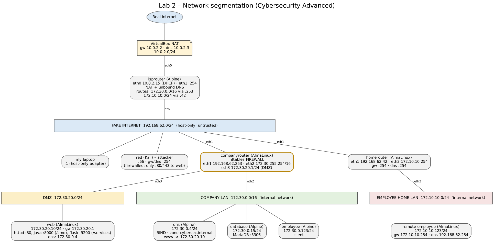

# Lab 2: Firewalls

## 1. Attacker machine red (recap lesson 1)

* **Can red ping all other devices?**
  * Yes, configured in lab 1: `192.168.62.66/24` on the fake internet.
* **Which routes need to be added? What is the default gateway?**
  * Default gateway: isprouter `192.168.62.254`. No extra routes are needed on red itself: isprouter already routes `172.30.0.0/16 via 192.168.62.253` (companyrouter) and `172.10.10.0/24 via 192.168.62.42` (homerouter), so red's traffic reaches the other subnets through its default gateway.
* **Does red have internet access?**
  * Yes, via isprouter (NAT/masquerade on its NAT interface) — the only machine that kept its VirtualBox NAT adapter. DNS server: `192.168.62.254`.

## 2. Red team attacks

* **Browse to http://www.cybersec.internal and http://www.cybersec.internal/cmd.**
  * The website loads over plain HTTP (no TLS). `/cmd` is a "Command Injection" web app with a *Ping* and an *Exec* form that run user input directly on the server, as root — arbitrary command execution.

* **Perform a default nmap scan on all machines. What is reachable?**
  * Fake internet `192.168.62.0/24` → laptop `.1` (SMB/RPC 135/139/445), homerouter `.42` and companyrouter `.253` (ssh, rpcbind), isprouter `.254` (ssh, dns; other ports `filtered` = firewall).
  * Company LAN `172.30.0.0/24` → no filtering at all from the "internet", every host fully reachable:
    * dns `.4`: 22, 53
    * web `.10`: 22, 80, 111, 8000
    * database `.15`: 22, **3306 (MySQL)**
    * employee `.123`: 22

## 3. Service enumeration (banner grab)

* **What database software is running on the database machine? What version?**
  * MariaDB (`5.5.5-10.11.11`), detected via `nmap -sV` on port 3306.

* **Use hydra to brute-force the database (try default user and "toor").**
  * `root` with "toor" or an empty password fails. Username `toor` with the rockyou wordlist succeeds:
    ```
    hydra -l toor -P /usr/share/wordlists/rockyou.txt mysql://172.30.0.15
    [3306][mysql] host: 172.30.0.15   login: toor   password: summer
    ```
  * Logging in confirms access to the `db_services` database:
    ```
    mysql -h 172.30.0.15 -u toor -psummer --ssl=0
    ```
  * Note: nmap's `mysql-enum` script reported every account as valid with an empty password — a **false positive** against this MariaDB version, disproved by the manual login (`Access denied`).

* **Try to SSH (vagrant/vagrant) from red to another machine. Is this possible?**
  * Yes. `ssh vagrant@172.30.0.10` succeeds with the default `vagrant`/`vagrant` credentials — weak, well-known credentials on every machine.

* **What webserver software is running on web?**
  * Apache httpd 2.4.62 (AlmaLinux). Port 8000 is the Java app behind `/cmd`, directly reachable (nmap misidentifies it as rtsp).

* **Try the `-sC` option with nmap. What does it do?**
  * `-sC` runs nmap's **default script scan** (equivalent to `--script=default`). On web it reveals the SSH host keys, the risky `TRACE` HTTP method, the page titles, and the full HTML of the command-injection app on port 8000.

* **Blue team: how is the webserver configured (in detail)?**
  * Apache acts as a **reverse proxy** (`mod_proxy`, `mod_proxy_http`), listening on port 80. Static content (`/var/www/html/index.html`) is served directly; dynamic content is proxied to two backend apps:
    * `/cmd`, `/exec`, `/assets` → `localhost:8000` — a **Java** app (`insecurewebapp.service`), the command-injection app.
    * `/services` → `localhost:9200` — a **Flask (Python)** app (`flaskapp.service`).
  * Services are managed by **systemd unit files**. Findings:
    * `flaskapp.service` is **failed** (`status=203/EXEC`): its `ExecStart` calls `/usr/bin/python`, which does not exist (only `/usr/bin/python3`). The `/services` route is therefore dead.
    * Both backend apps run as `User=root` — no privilege separation.
    * `httpd.conf` contains a broken `ProxyPassReverse "/aaa"` that does not match its `ProxyPass "/cmd"`.
    * The `TRACE` method is enabled (Cross-Site Tracing risk).

## 4. Network segmentation

* **What is meant by "attack vector"?**
  * The path or method an attacker uses to gain access to a system.

* **Is there already network segmentation on the internal network?**
  * No. Everything is reachable from everywhere — no zones, no filtering.

* **What is a DMZ? Which machines belong in it here? Are there multiple ways to configure it?**
  * A DMZ (demilitarized zone) is a separate segment between the untrusted external network and the trusted internal network, holding services that must be reachable from outside.
  * Here: **web** (and optionally **dns**), since they must be reachable externally.
  * Yes — e.g. a three-legged firewall (one firewall, three interfaces), a dual-firewall architecture, or a VLAN-based DMZ.

* **What can be annoying about network segmentation?**
  * Client–server applications can break if a required port/path is not explicitly allowed; more rules to configure and harder troubleshooting.

* **Implementation overview.**
  * Added a new **DMZ segment** (`172.30.20.0/24`) on companyrouter as `eth3` (`172.30.20.1`).
  * Moved **web** into the DMZ: adapter 2 switched to the `dmz` internal network, IP changed to `172.30.20.10/24`, gateway `172.30.20.1`.
  * Updated the **DNS** A-record (and PTR) for `www.cybersec.internal` from `172.30.0.10` to `172.30.20.10`, bumped the zone serial, reloaded BIND.
  * Configured **companyrouter as an nftables firewall** (see §5).
  * red can no longer resolve internal names, so a manual `/etc/hosts` entry (`172.30.20.10 www.cybersec.internal`) is added on red — allowed by the assignment.



* **What functionality is lost from the fake internet after segmentation?**

  | Category | Lost functionality | Justification |
  |---|---|---|
  | Discovery | ICMP / ping to internal hosts | Prevents host detection and mapping |
  | Scanning | TCP/UDP port scanning | Hides vulnerable internal services |
  | Services | Internal DNS (53) | Attacker can no longer resolve internal names |
  | Lateral access | Direct database access (3306) | Prevents direct data exfiltration |
  | Management | SSH to router/servers | Blocks unauthorized logins |

  * Trade-off: the admin laptop sits on the fake-internet segment too, so it also loses direct SSH to the internal/DMZ machines — these are now managed via the VirtualBox console or an internal host.

## 5. Firewall (nftables on companyrouter)

* **Firewall ruleset.** Interfaces: `eth1` = fake internet, `eth2` = internal LAN, `eth3` = DMZ. Default policy `drop`; only explicitly needed flows are allowed.
  ```nft
  flush ruleset

  table inet filter {
      chain input {
          type filter hook input priority 0; policy drop;
          iif lo accept
          ct state established,related accept
          iif "eth2" accept                 # internal LAN may manage the router
          iif "eth1" tcp dport 22 accept     # SSH bastion access from the fake internet (needed for lab 3 ProxyJump)
      }

      chain forward {
          type filter hook forward priority 0; policy drop;
          ct state established,related accept

          # Fake internet -> company website in DMZ (HTTP/HTTPS only)
          iif "eth1" oif "eth3" ip daddr 172.30.20.10 tcp dport { 80, 443 } accept
          # Internal LAN -> company website in DMZ
          iif "eth2" oif "eth3" ip daddr 172.30.20.10 tcp dport { 80, 443 } accept
          # Web (DMZ) -> database (MySQL)
          iif "eth3" oif "eth2" ip daddr 172.30.0.15 tcp dport 3306 accept
          # Web (DMZ) -> internal DNS
          iif "eth3" oif "eth2" ip daddr 172.30.0.4 udp dport 53 accept
          iif "eth3" oif "eth2" ip daddr 172.30.0.4 tcp dport 53 accept
          # Internal LAN -> internet
          iif "eth2" oif "eth1" accept
          # Internal DNS (BIND) -> isprouter resolver (recursive lookups)
          iif "eth2" oif "eth1" ip saddr 172.30.0.4 ip daddr 192.168.62.254 udp dport 53 accept
          iif "eth2" oif "eth1" ip saddr 172.30.0.4 ip daddr 192.168.62.254 tcp dport 53 accept
      }

      chain output {
          type filter hook output priority 0; policy accept;
      }
  }

  table ip nat {
      chain postrouting {
          type nat hook postrouting priority 100; policy accept;
          oif "eth1" masquerade             # NAT internal traffic to the internet
      }
  }
  ```
  * Stored in `/etc/sysconfig/nftables.conf`, validated with `nft -c -f`, loaded via `systemctl enable --now nftables`.
  * **SSH bastion access:** `iif "eth1" tcp dport 22 accept` allows SSH from the fake internet straight to companyrouter itself — this is what makes companyrouter usable as an SSH bastion (see lab 3) even with the firewall active. Without it, `ssh ca-companyrouter` (and every `ProxyJump` through it) would be blocked by the `policy drop` on `input`.

* **Verification.**
  * From red: `curl -I http://www.cybersec.internal` → `HTTP/1.1 200 OK` (website still reachable).
  * From red: `nmap -p 22,3306 172.30.0.15` → host unreachable (internal machines blocked).
  * From employee: `ping 8.8.8.8` and `ping google.com` both succeed (internal keeps internet + DNS).

## 6. Open, closed, filtered ports

* **Scan web on ports 22, 80, 666 with the firewall active, then again with it disabled. Explain.**
  * Firewall **active**:
    ```
    22/tcp  filtered ssh
    80/tcp  open     http
    666/tcp filtered doom
    ```
  * Firewall **disabled** (`nft flush ruleset`):
    ```
    22/tcp  open   ssh
    80/tcp  open   http
    666/tcp closed doom
    ```
  * **open** = a service is listening and accepts the connection. **closed** = the host is reachable but nothing listens on that port, so it replies with a TCP RST. **filtered** = a firewall silently drops the packet, so nmap gets no reply at all. Because our firewall uses `policy drop` (not `reject`), blocked ports show as `filtered` rather than `closed`.

## Revert to insecure state

* **Disable the firewall (quick toggle).** On companyrouter:
  ```bash
  sudo systemctl stop nftables
  sudo systemctl disable nftables
  ```
  red immediately reaches all machines again.

* **Undo the segmentation (optional, full revert).**
  * web: switch adapter 2 back to `internal-company-lan`, restore `ifcfg-eth1` to `172.30.0.10/16`, gateway `172.30.255.254`.
  * dns: restore the original zone file and reload:
    ```bash
    sudo cp /var/bind/cybersec.internal.before-dmz /var/bind/cybersec.internal
    sudo rc-service named reload
    ```
  * Remove the manual `/etc/hosts` entry on red.