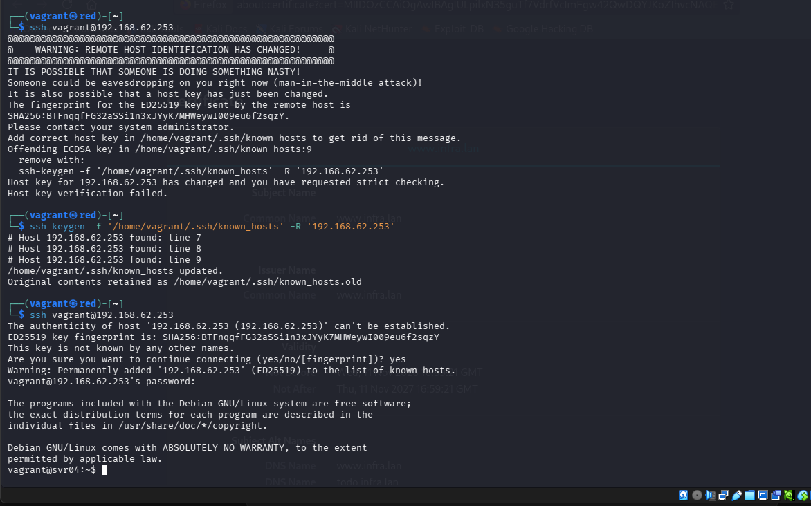
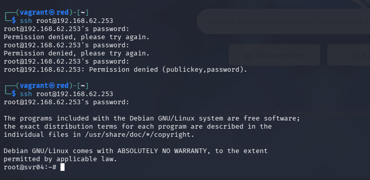
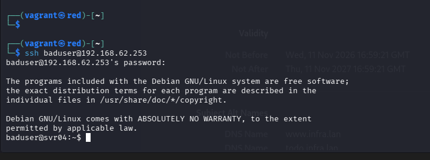

# Lab 4: Honeypots

## Cowrie

* **Why is companyrouter an interesting device for an SSH honeypot? What's a good argument NOT to do this?**
  * Interesting: it's the first device an attacker on the fake internet encounters — the "front door" to the company network, a realistic place to lure and observe attackers before they ever reach real systems.
  * Against it: companyrouter is a critical, actively managed system (the firewall/bastion itself). Adding an extra service increases the attack surface of a machine that should have as little as possible. A compromised honeypot container on the same host as the firewall is riskier than one on a separate, isolated machine.

* **Change SSH to listen on 2222 instead of 22.**
  * `/etc/ssh/sshd_config`: `Port 2222`.
  * AlmaLinux's SELinux blocks sshd from binding non-standard ports by default (`Bind to port 2222 ... Permission denied`). Fixed with:
    ```bash
    sudo semanage port -a -t ssh_port_t -p tcp 2222
    ```
  * The firewall's `input` chain also needed updating (it only allowed `tcp dport 22` from `eth1`) to allow `2222` instead, and `~/.ssh/config` on the laptop updated with `Port 2222` for the `ca-companyrouter` alias.

* **Install Cowrie, listening on port 22.**
  * Installed via Docker:
    ```bash
    sudo docker run -d --name cowrie -p 22:2222 cowrie/cowrie:latest
    ```
  * **Finding**: Docker publishes ports through its own DNAT rules in the `nat` table, which (after rewriting the destination to the container) require the packet to pass through the **forward** chain to reach the `docker0` bridge. Our own firewall's forward chain (`policy drop`) blocked this by default — had to add:
    ```bash
    sudo nft add rule inet filter forward iif eth1 oif docker0 accept
    sudo nft add rule inet filter forward iif docker0 oif eth1 ct state established,related accept
    ```

* **Verify you can still SSH normally on port 2222.**
  * Confirmed: `ssh -p 2222 vagrant@192.168.62.253` logs into the real shell.

* **Attack the router, try to SSH normally. What do you notice?**
  * SSH to port 22 immediately shows a **host key warning**: `WARNING: REMOTE HOST IDENTIFICATION HAS CHANGED!` — Cowrie presents a different SSH host key than the real sshd (which `red` had cached from before). This is itself a strong giveaway.

  

* **Which credentials work? Which don't?**
  * Almost everything works by default — including a typo'd password (`vagrant`/`vqgrqnt`) and a completely made-up username (`baduser`/`vagrant`), both logged as `cowrie.login.success`. Even `richard` (sometimes cited as a default-denied example user) was accepted in this Cowrie version/image.
  * One credential reliably fails: **`root` with the literal password `root`** — rejected three times (`Permission denied, please try again`), matching the built-in rule (visible in `userdb.example`: `root:x:!root`, `root:x:!123456`, `root:x:!/honeypot/i`, `root:x:*`). `root` with any *other* password succeeds and returns a root shell (`root@svr04:~#`).
  * This shows Cowrie denies a few obvious/well-known root passwords specifically, while accepting virtually anything else — itself a detectable pattern for a careful attacker (a real system doesn't selectively block only `root`/`root` while accepting every other combination).

  

* **Do you get a shell?**
  * Yes — a fully interactive fake shell (`vagrant@svr04:~$`), backed by a simulated filesystem (honeyfs), not a real OS. Commands (`whoami`, `id`, `cat /etc/passwd`, `uname -a`) were tested and confirmed logged (see §"Are commands logged" below).



* **Are commands logged? Is the client IP logged? Where?**
  * Yes to both, in `/cowrie/cowrie-git/var/log/cowrie/cowrie.json` (JSON lines, one event per line) inside the container. Example entries:
    ```json
    {"session":"b881d16ed0ee","src_ip":"192.168.62.43","username":"vagrant","password":"vqgrqnt","eventid":"cowrie.login.success", ...}
    {"session":"b881d16ed0ee","src_ip":"192.168.62.43","input":"whoami","eventid":"cowrie.command.input", ...}
    {"session":"b881d16ed0ee","src_ip":"192.168.62.43","input":"cat /etc/passwd","eventid":"cowrie.command.input", ...}
    ```
  * Every command (`whoami`, `id`, `cat /etc/passwd`, `uname -a`, `exit`) and the attacker's real source IP/port are captured, plus a full TTY replay log (`var/lib/cowrie/tty/<hash>`) that can replay the entire session.

* **Can an attacker perform malicious things?**
  * Only within the simulated honeyfs — commands appear to execute (e.g. `cat /etc/passwd` returns a fake passwd file) but nothing touches the real host or container filesystem meaningfully; it's a controlled illusion, not real code execution.

* **How would an experienced attacker realize this isn't a real environment?**
  * Several tells stack up: (1) the SSH host key doesn't match what was seen before on the real service, (2) the hostname in the shell prompt (`svr04`) doesn't match the router's real hostname (`companyrouter`), (3) the banner claims **Debian GNU/Linux** while the real companyrouter runs **AlmaLinux**, and (4) literally any username/password combination is accepted — no real production server behaves that way.

## Critical thinking: "Docker as a service"

* **At least 2 advantages of running services via Docker:**
  * Isolation: the service runs in its own filesystem/namespace, limiting the blast radius if compromised, and avoids dependency conflicts with the host.
  * Portability and fast deployment/teardown: a honeypot can be spun up, reset, or destroyed in seconds with a known-good image, without touching the host's own package set.

* **A disadvantage:**
  * Extra attack surface / complexity: running a container daemon adds its own privileged process and its own networking (iptables-nft rules, as we saw) that can unexpectedly interact with the host's own firewall — exactly the forward-chain issue encountered above.

* **"Docker uses a client-server architecture" — explain.**
  * The Docker CLI (`docker` command) is a thin client that talks over a socket/API to the **Docker daemon** (`dockerd`), which does the actual work (building, running, networking containers). The client and daemon can even run on different machines.

* **As which user does the Docker daemon run by default?**
  * As **root** (it runs with full root privileges on the host, which is why group membership in `docker` is effectively equivalent to root access — per Docker's own post-install documentation).

* **Advantage of a honeypot in a VM vs. a container?**
  * Stronger isolation: a VM has its own kernel, so a container escape (breaking out of the container's shared-kernel sandbox) can't lead directly to host compromise the way it theoretically could from a container, which shares the host kernel.

## Docker deepdive (Portainer)

* **Why mount `/var/run/docker.sock`?**
  * Portainer needs to talk to the Docker daemon's API to manage containers (list, start, stop, inspect) — it does so through this socket, exactly like the `docker` CLI does.

* **What is `docker.sock`?**
  * A Unix socket that exposes the Docker Engine API — anything connected to it can issue any Docker command the daemon supports.

* **Why is mounting it a security risk?**
  * Whoever/whatever has access to `docker.sock` effectively has **root on the host**: they can start a new container with the host's root filesystem bind-mounted in, and freely read/write/modify anything on the host from inside that container. Mounting the socket into a container is equivalent to giving that container (and anyone who can reach it, e.g. via a vulnerability in Portainer) full root access to the underlying machine.

## Other honeypots

* **What type of honeypot is "honeyup"?**
  * A honeypot that mimics an FTP upload service, used to detect/trap automated bots probing for insecure file-upload endpoints.

* **What is the idea behind "opencanary"?**
  * A low-interaction, multi-protocol honeypot/"canary" that emulates many common services (SSH, FTP, HTTP, SMB, etc.) at once and fires an alert the moment any of them is touched — designed as an early-warning tripwire rather than deep deception.

* **Is an HTTP(S) honeypot a good idea? Why (not)?**
  * Can be useful — web services are a very common attack surface, so it captures scanning/exploitation attempts (SQLi, path traversal, credential stuffing on login forms). Downside: convincingly imitating a specific real application is harder than SSH, so it's more work to keep believable and avoid detection by a careful attacker.

* **If our `/cmd` endpoint were a honeypot, how would we retrieve the commands a hacker entered? Is this feasible?**
  * Since `/cmd` just forwards form input to a Java app that executes it, the commands would have to be captured at the application layer (e.g. in the Apache access log as the POST body, or by adding logging inside the Java app itself) — unlike Cowrie, there's no built-in structured logging, so this would require custom instrumentation. Feasible, but not out-of-the-box.