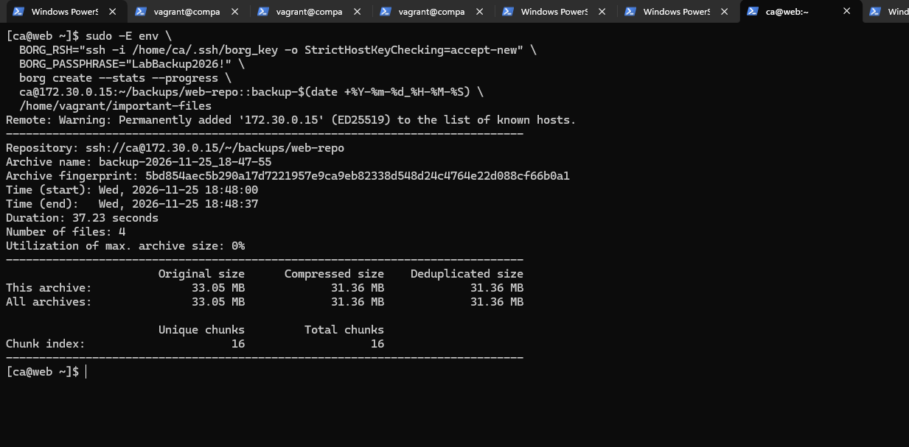
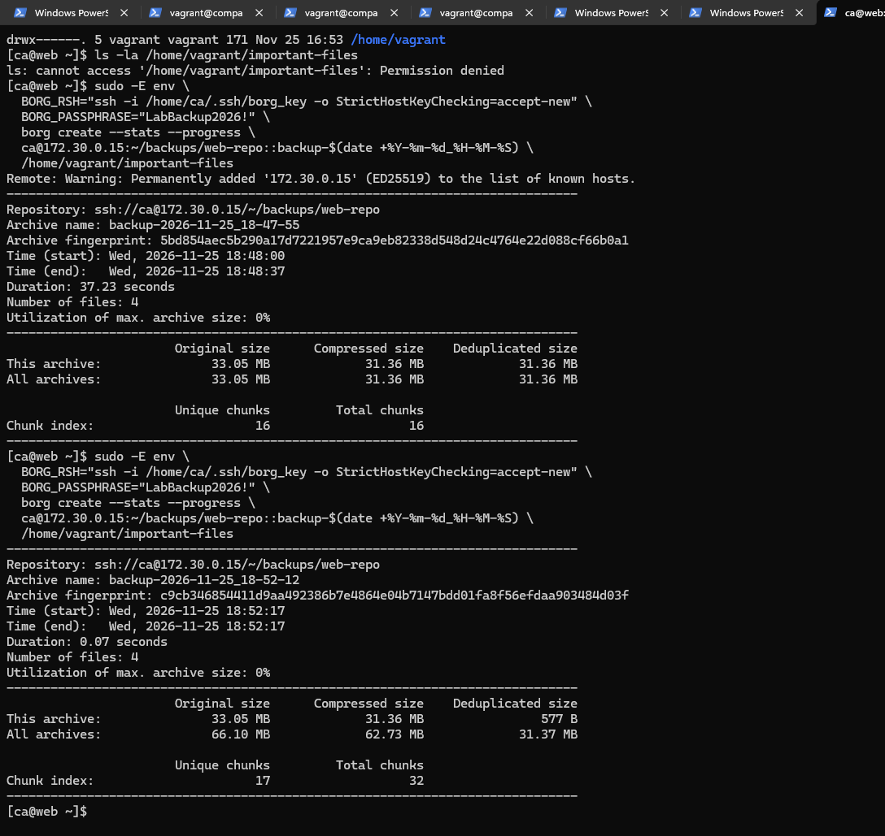
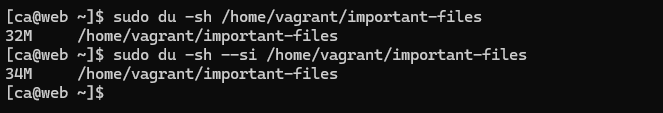
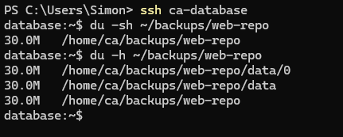
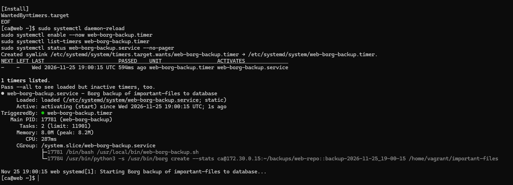
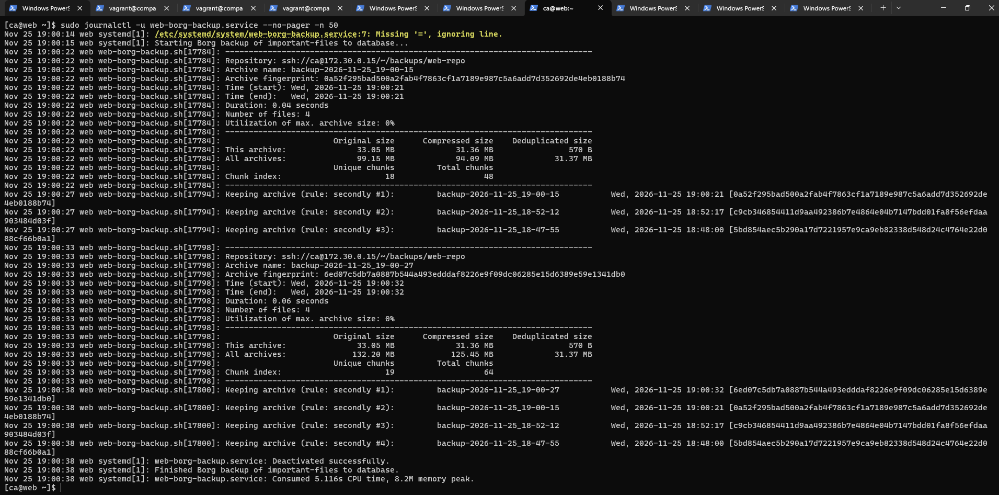
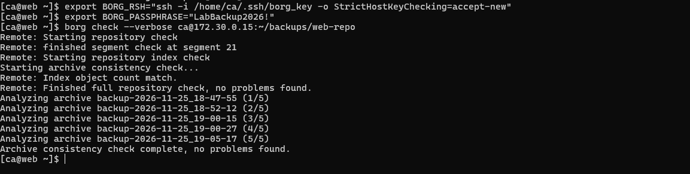
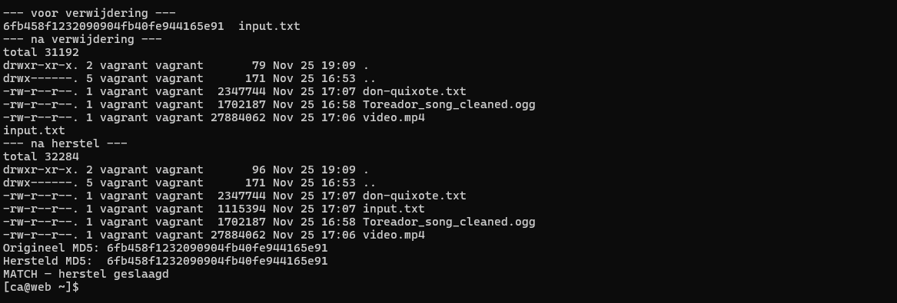

# Lab 5 - Backups with BorgBackup

**What is BorgBackup, and why use it over a plain `cp`/`rsync` backup?**
  - Borg is a deduplicating, encrypted, incremental backup tool.
  - It splits files into content-defined chunks and only stores a chunk once, even if it appears in multiple files or multiple backup runs — this is what makes repeated backups of mostly-unchanged data extremely fast and space-efficient.
  - All data is compressed and authenticated-encrypted client-side before it ever leaves the source machine, so the backup target never sees plaintext.

**Which machines are involved, and what is the backup architecture?**
  - `web` (AlmaLinux) holds the source data (`/home/vagrant/important-files`, 4 test files: a text file, a book, a video, and an audio file).
  - `database` (Alpine) hosts the Borg repository and only receives data over SSH — it never needs to read the source files directly.
  - `web` pushes backups to `database` using a dedicated SSH keypair (`~/.ssh/borg_key`, Ed25519, no passphrase) created specifically for the `ca` user's borg access, separate from the general administrative key used for interactive logins.

**How was BorgBackup installed on each machine?**
  - On `web` (AlmaLinux 9): `sudo crb enable` (enables the CodeReady Builder repo), then `sudo dnf install borgbackup -y`, which pulled `borgbackup` (1.2.9) from EPEL along with its Python dependencies.
  - On `database` (Alpine): `apk add borgbackup` (1.2.7), no extra repo needed.
  - The two versions (1.2.9 / 1.2.7) are fully compatible with each other.

**Did any firewall changes have to be made for the backup connection to work?**
  - Yes. `web` and `database` sit on different subnets (`172.30.20.0/24` and `172.30.0.0/24`), routed through `companyrouter`.
  - `companyrouter`'s `forward` chain only allowed `web → database` traffic on `tcp/3306` (the database's own MySQL port) and `tcp+udp/53` to the internal DNS server — SSH (22) was not permitted, by design (least privilege).
  - A new rule was added to `/etc/sysconfig/nftables.conf`:
    `iif "eth3" oif "eth2" ip daddr 172.30.0.15 tcp dport 22 accept`
    specifically to allow the backup connection, and nftables was reloaded.

**How was the repository initialized, and what encryption mode was chosen?**
  - From `web`: `borg init --encryption=repokey ca@172.30.0.15:~/backups/web-repo`
  - `repokey` mode stores the encryption key inside the repository itself (encrypted with a passphrase), as opposed to `keyfile` mode where the key lives only on the client.
  - `borg info` confirms: `Encrypted: Yes (repokey)`, with a unique Repository ID.

**Why export the key separately, and where was it stored?**
  - Even in `repokey` mode, Borg explicitly warns that both the key *and* the passphrase are required to ever read the repository again — losing either one makes the backup permanently unreadable.
  - The key was exported with `borg key export` to a text file, which was then copied off `web` to the local machine via `scp`, so the key does not depend on the survival of the `web` VM itself.

**What happened when the first backup was created?**
  - `borg create --stats ... ca@172.30.0.15:~/backups/web-repo::backup-<timestamp> /home/vagrant/important-files`
  - Result: 4 files, 33.05 MB original → 31.36 MB compressed/deduplicated, 16 unique chunks of 16 total (expected, since this is the first archive — nothing to deduplicate against yet).

**What happened on the second backup, with unchanged files, and what does that show about deduplication?**
  - The second backup completed in 0.07 seconds (vs. ~37 seconds for the first).
  - "This archive" deduplicated size: only 577 B, because nearly all chunks already existed in the repository from the first backup.
  - "All archives" totals: Original size doubled to 66.10 MB (it counts every archive's logical size), but Deduplicated size barely grew (31.36 MB → 31.37 MB) — proof that unchanged data is not stored twice.
  - Chunk index: 17 unique chunks of 32 total (only 1 new chunk, from the archive's own metadata).

**How does on-disk usage compare between the source and the repository?**
  - Source data on `web`: `du -sh /home/vagrant/important-files` → 32M.
  - Repository on `database` after 2 backups: `du -sh ~/backups/web-repo` → 30.0M.
  - Without deduplication, 2 backups of 32M would need ~64M; instead the repository stayed smaller than even a single copy, thanks to deduplication plus compression.

**How was the backup process automated, and what retention policy was used?**
  - A script (`/usr/local/bin/web-borg-backup.sh`) runs `borg create` followed by `borg prune` with a Grandfather-Father-Son style retention policy: `--keep-last=5 --keep-daily=7 --keep-weekly=4 --keep-monthly=6`.
  - GFS keeps multiple tiers of backups (most recent runs, then daily, weekly, monthly snapshots) so you get fine-grained recent recovery points without keeping every backup forever.
  - A systemd service (`web-borg-backup.service`, `Type=oneshot`) runs the script, triggered by a systemd timer (`web-borg-backup.timer`, `OnUnitActiveSec=5min` for lab-testing purposes) instead of a daily/weekly schedule.
  - Because backups in this test ran only seconds apart, `borg prune` classified them under its finest-grained "secondly" rule rather than "daily" — with a realistic once-a-day production schedule, the same policy would show the daily/weekly/monthly tiers instead.

**How was repository integrity verified?**
  - `borg check --verbose ca@172.30.0.15:~/backups/web-repo`
  - Output: "Finished full repository check, no problems found" and "Archive consistency check complete, no problems found" across all 5 kept archives.

**How was a deleted file restored, and how was the restore verified?**
  - `input.txt` was deleted from `/home/vagrant/important-files`, after first recording its MD5 checksum.
  - It was restored with:
    `borg extract --list ca@172.30.0.15:~/backups/web-repo::<archive> home/vagrant/important-files/input.txt --strip-components 3`
    run from inside the target directory, with `--strip-components 3` removing the `home/vagrant/important-files` prefix stored in the archive so the file lands directly in the current directory.
  - The MD5 checksum of the restored file matched the original exactly, confirming a bit-for-bit correct restore.

**What does `borg compact` do, and why is it a separate command from `prune`?**
  - `prune` only marks old archives as no longer needed; it does not immediately reclaim disk space.
  - `compact` physically removes the now-unreferenced data from the repository's segment files.
  - They are kept separate so that pruning (a metadata operation) can't accidentally cause data loss if interrupted mid-compaction. In this lab, `borg compact` freed about 5 kB — small because the pruned archives shared almost all their chunks with the archives that were kept.

**Can Borg safely back up an actively-running database?**
  - Not directly and safely by default. Borg operates at the file level: it reads whatever is on disk at the moment it runs, with no awareness of the database's internal state.
  - A live database may have data in memory buffers not yet flushed, or be mid-transaction, so a raw file-level backup of its data files can capture an inconsistent, non-atomic snapshot that fails to restore correctly.
  - Safe approaches: stop the database during the backup window, produce an application-consistent dump first (e.g. `mysqldump`/`pg_dump`) and back up that dump file instead of the raw data files, or take an atomic filesystem-level snapshot (LVM/ZFS/Btrfs) and back up the snapshot. Borg itself has no database-aware mode — consistency has to be guaranteed before Borg ever sees the files.

**What is Borgmatic, and how does it relate to what was built manually here?**
  - Borgmatic is a Python wrapper around Borg that replaces hand-rolled shell scripts and systemd units with a single declarative YAML configuration file.
  - It runs `borg create`, `prune`, `compact`, and `check` in sequence automatically according to that configuration, and supports hooks (e.g. running `mysqldump` before the backup and cleaning it up after) — directly addressing the "safe database backup" problem above in a standardized, reusable way instead of custom scripting.