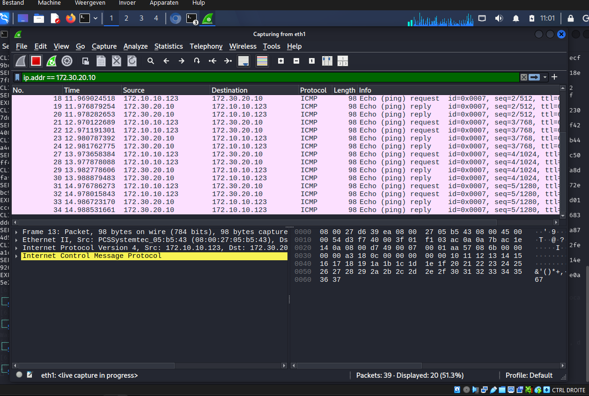
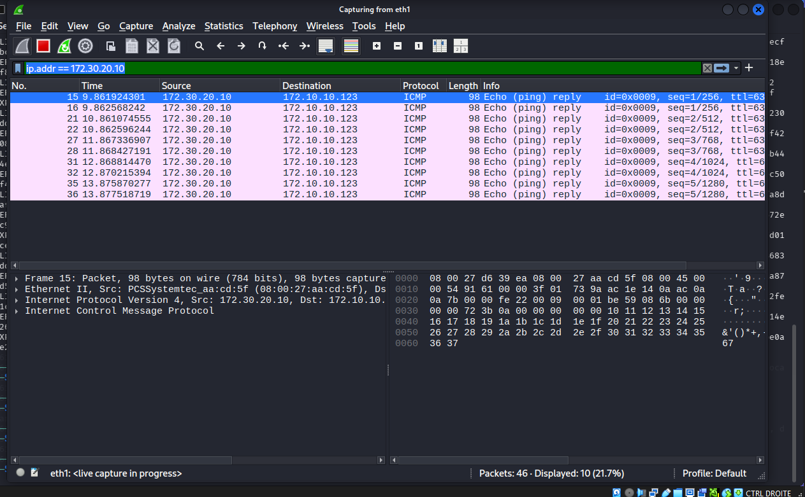
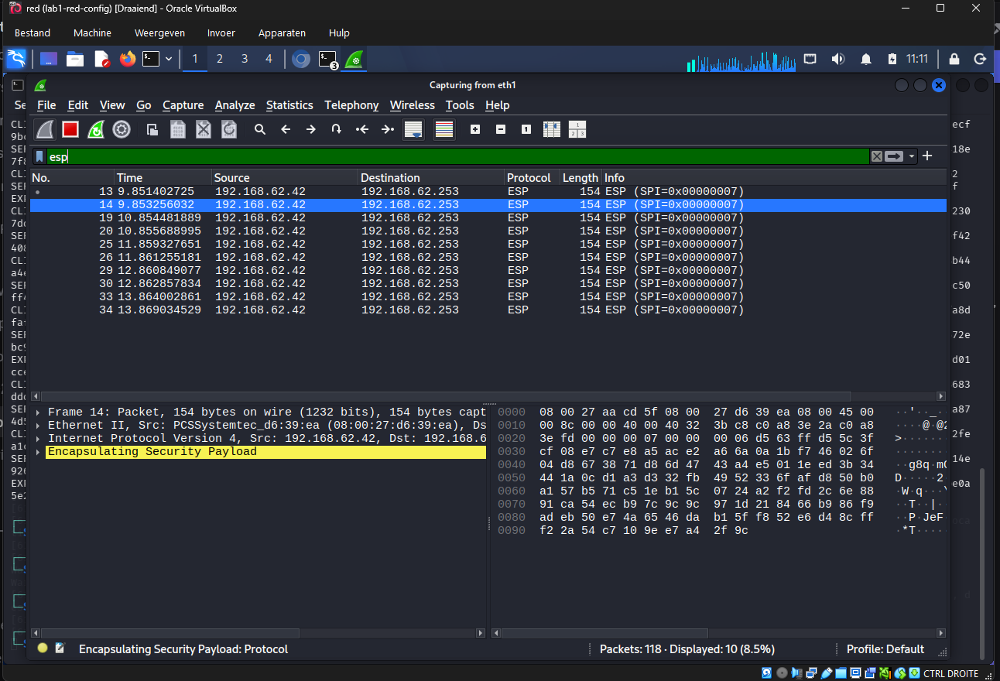
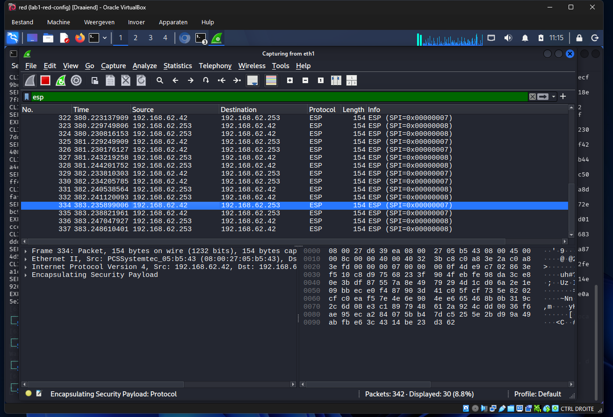
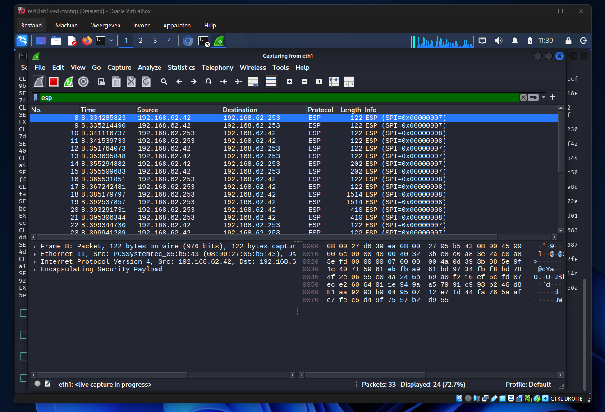
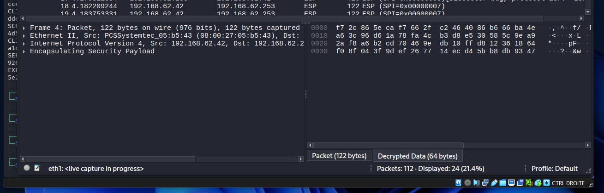

# Lab 8 – Manual IPsec Tunnel

## 0. Topology

| VM | Role | Interfaces |
|---|---|---|
| `homerouter` | Home-office router | `eth1`: `192.168.62.42` (fake internet) · `eth2`: `172.10.10.254` (employee_home_lan) |
| `remote_employee` | Client at home | `eth1`: `172.10.10.123` |
| `companyrouter` | Company router | `eth1`: `192.168.62.253` (fake internet) · `eth2`: `172.30.255.254/16` (internal) · `eth3`: `172.30.20.1` (DMZ) |
| `web` | Target server (DMZ) | `172.30.20.10` |
| `red` | Attacker / packet capture | `192.168.62.43` (same segment as the two routers) |

```
 [remote_employee]---172.10.10.0/24---[homerouter]===192.168.62.0/24===[companyrouter]---172.30.0.0/16---[web]
   172.10.10.123         eth2:.254      eth1:.42    |         eth1:.253     eth3:.1        172.30.20.10
                                                      |
                                                   [red] 192.168.62.43  <-- ARP-spoofs the link above
```

Manual IPsec tunnel endpoints: `192.168.62.42` (homerouter) ↔ `192.168.62.253` (companyrouter).

## 1. Network Setup & Verification

```bash
# homerouter: confirm IP forwarding + interfaces
sysctl net.ipv4.ip_forward
ip addr

# remote_employee: confirm internet/DNS + interfaces
ip addr
ip route
ping -c3 1.1.1.1
ping -c3 google.com
```

Direct routes between the two routers (so traffic doesn't go via `isprouter`):

```bash
# homerouter
sudo ip route add 172.30.0.0/16 via 192.168.62.253

# companyrouter
sudo ip route add 172.10.10.0/24 via 192.168.62.42
```

`companyrouter`'s firewall was temporarily disabled to validate reachability before adding IPsec-specific rules:

```bash
sudo systemctl stop nftables
```

Verified from `remote_employee`: `ping` to `companyrouter` (`192.168.62.253`) and to `web` (`172.30.20.10`) both succeed.

## 2. MitM Attack (ettercap)

ARP-spoof the link between the two routers from `red`, so all traffic between them passes through `red`:

```bash
sudo ettercap -Tq -i eth1 -M arp:remote /192.168.62.42// /192.168.62.253//
```

**Target syntax:** ettercap's `TARGET` format is `MAC/IP/PORT` — three fields separated by two slashes, where an empty field means "any". In `/192.168.62.42//`, the leading slash marks an empty **MAC** field (any MAC), `192.168.62.42` is the **IP** field, and the double slash afterwards closes the (empty) **PORT** field — i.e. "this IP, any MAC, any port".

With a ping from `remote_employee` to `web` running, the ICMP traffic is visible in plaintext on `red`, confirming the MitM position:



## 3. IPsec Set-up

### 3.1 One-way encryption: homerouter → companyrouter

```bash
#!/usr/bin/env sh
ip xfrm policy flush
ip xfrm state flush
SPI7=0x007
ENCKEY7=0xFEDCBA9876543210FEDCBA9876543210
ip xfrm state add \
  src 192.168.62.42 dst 192.168.62.253 \
  proto esp spi ${SPI7} mode tunnel enc aes ${ENCKEY7}
ip xfrm policy add \
  src 172.10.10.0/24 dst 172.30.0.0/16 dir out \
  tmpl src 192.168.62.42 dst 192.168.62.253 proto esp spi ${SPI7} mode tunnel
```

Run on `homerouter`. The counterpart on `companyrouter` reuses the **same SA** (same key/SPI — both ends must agree), but the policy direction changes from `out` to `fwd`, because the decrypted traffic is destined for `web`, not for `companyrouter` itself (`dir in` would only apply if the traffic's final destination were the router itself):

```bash
#!/usr/bin/env sh
ip xfrm policy flush
ip xfrm state flush
SPI7=0x007
ENCKEY7=0xFEDCBA9876543210FEDCBA9876543210
ip xfrm state add \
  src 192.168.62.42 dst 192.168.62.253 \
  proto esp spi ${SPI7} mode tunnel enc aes ${ENCKEY7}
ip xfrm policy add \
  src 172.10.10.0/24 dst 172.30.0.0/16 dir fwd \
  tmpl src 192.168.62.42 dst 192.168.62.253 proto esp spi ${SPI7} mode tunnel
```

Result on `red` (ping from `remote_employee` to `web`): the **request** is now `ESP`, the **reply** is still plaintext `ICMP` (the tunnel only works in this one direction).




### 3.2 Encryption in the opposite direction: companyrouter → homerouter

Generate a new random key:

```bash
dd if=/dev/random count=24 bs=1 2>/dev/null | xxd -ps
```

Add a **second**, independent SA/SP pair (without flushing the first one):

```bash
# companyrouter
SPI8=0x008
ENCKEY8=0x2c91b86d7c7ae6fbffb98398d443b61ebe44c6992ef528df
ip xfrm state add \
  src 192.168.62.253 dst 192.168.62.42 \
  proto esp spi ${SPI8} mode tunnel enc aes ${ENCKEY8}
ip xfrm policy add \
  src 172.30.0.0/16 dst 172.10.10.0/24 dir out \
  tmpl src 192.168.62.253 dst 192.168.62.42 proto esp spi ${SPI8} mode tunnel
```

```bash
# homerouter (dir fwd: traffic is destined for remote_employee, not homerouter itself)
SPI8=0x008
ENCKEY8=0x2c91b86d7c7ae6fbffb98398d443b61ebe44c6992ef528df
ip xfrm state add \
  src 192.168.62.253 dst 192.168.62.42 \
  proto esp spi ${SPI8} mode tunnel enc aes ${ENCKEY8}
ip xfrm policy add \
  src 172.30.0.0/16 dst 172.10.10.0/24 dir fwd \
  tmpl src 192.168.62.253 dst 192.168.62.42 proto esp spi ${SPI8} mode tunnel
```

**Answer:** yes, encryption in both directions is achieved — two independent, unidirectional SA/SP pairs, one per direction, each with its own key and SPI.

Capture on `red` filtered on `esp` now shows **both** SPIs (`0x7` and `0x8`) and no plaintext ICMP at all:



### 3.3 Endgame: firewall back on

Re-enabling `companyrouter`'s firewall initially broke the tunnel — `curl` to `web` timed out, even though the existing forward rules already allowed `172.30.20.10:80/443` from `eth1`. Root cause: the **inbound ESP packet itself** is addressed to `companyrouter`'s own IP and is therefore evaluated by the `input` chain *before* the kernel ever gets to decrypt it. The ruleset had no rule allowing protocol ESP (IP protocol 50), so the encrypted packet was dropped before IPsec processing — confirmed via `cat /proc/net/xfrm_stat` showing **zero** errors (the packet never reached XFRM at all) and `ip -s xfrm state` showing stale packet counters.

**Answer:** an inbound IPsec tunnel needs an explicit firewall rule allowing the ESP protocol on the `input` chain, scoped to the tunnel peer, in addition to any `forward` rules for the decrypted traffic itself:

```bash
sudo nft add rule inet filter input iif "eth1" ip saddr 192.168.62.42 ip protocol esp accept
```

Persisted into `/etc/sysconfig/nftables.conf` (survives a VM/service restart):

```bash
sudo sed -i '11a\        iif "eth1" ip saddr 192.168.62.42 ip protocol esp accept   # IPsec tunnel from homerouter' /etc/sysconfig/nftables.conf
sudo nft -c -f /etc/sysconfig/nftables.conf && echo "syntax OK"
sudo systemctl restart nftables
```

With this rule in place, `curl http://172.30.20.10` from `remote_employee` succeeds, and `red` only ever sees ESP traffic — the full HTTP request/response is invisible to the MitM despite the active ARP-spoof:



*(The remote internal network itself needs no separate firewall for this exercise — only `companyrouter`'s firewall is relevant here, since that is the tunnel endpoint facing the attacker-monitored link.)*

### 3.4 Decryption with the known static key

**Question:** knowing the static key and SPI, can the captured traffic be decrypted afterwards?

**Answer:** yes. Unlike TLS 1.3 (ephemeral Diffie-Hellman, Perfect Forward Secrecy), this manual IPsec setup uses a **static, symmetric AES key** with no key exchange at all — anyone who obtains the key and SPI (e.g. by reading the setup script) can decrypt every past and future packet for that SA.

Demonstrated in Wireshark: Edit → Preferences → Protocols → ESP → enable both detection options → add the SA under "ESP SAs":

| Src IP | Dst IP | SPI | Encryption | Key | Authentication |
|---|---|---|---|---|---|
| 192.168.62.42 | 192.168.62.253 | 0x00000007 | AES-CBC [RFC3602] | `fedcba9876543210fedcba9876543210` | NULL |

(Authentication is NULL since the script only configures `enc`, no `auth` — no integrity/HMAC check, encryption only.)



## 4. Further Work (not required)

NAT traversal for IPsec requires cooperation from the NAT device (UDP encapsulation of ESP, since plain ESP has no ports for NAT to rewrite) and was out of scope for this lab.

## 5. Persistence Note

The `ip xfrm state`/`ip xfrm policy` commands are **not persistent** — they must be re-run after every reboot of `homerouter`/`companyrouter` (no systemd service was set up for this manual demo). The saved scripts (`ipsec-tunnel1.sh`, `ipsec-tunnel2.sh`) remain on each VM for that purpose. The ESP firewall rule, by contrast, **is** persisted in `/etc/sysconfig/nftables.conf` and survives a restart.