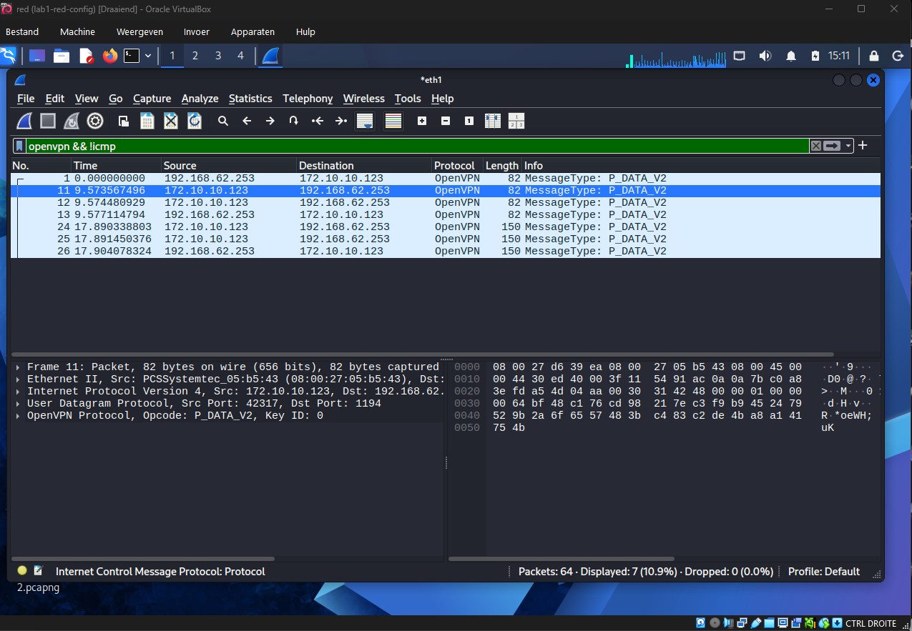

# Lab 9 – OpenVPN

## 1. OpenVPN vs IPsec

IPsec operates at the network layer (L3): it tunnels IP traffic directly and is mainly used router-to-router within a single organization. OpenVPN operates at the transport layer (L4): it builds an SSL/TLS tunnel (like HTTPS) and routes an entire L3 network through that L4 connection, making it easier to traverse NATs/firewalls and far more common for individual remote clients (road warriors).

## 2. Topology

```
remote_employee (employee_home_lan)
        |
   homerouter (bastion)
        |
192.168.62.0/24 (ISP segment, monitored by red via ARP MitM)
        |
companyrouter — OpenVPN server (192.168.62.253:1194/udp)
        |
172.30.0.0/16 (internal company network)
        |
      web (172.30.20.10)
```

A separate PKI/CA was created for this lab instead of reusing the Lab 6 (HTTPS) CA, so that Lab 9 can be demonstrated independently without depending on Lab 6's environment being up.

## 3. Server software installation (companyrouter)

```bash
sudo dnf install -y epel-release          # required for easy-rsa package
sudo dnf install -y openvpn easy-rsa

openvpn --version        # 2.5.11 (lab requires >= 2.5.9)
/usr/share/easy-rsa/3/easyrsa --version    # 3.2.1 (lab requires >= 3.1.6)
```

Both versions exceed the lab's minimum requirements.

## 4. Setting up the PKI with Easy-RSA

```bash
mkdir -p ~/pki-openvpn && cd ~/pki-openvpn
ln -s /usr/share/easy-rsa/3/* .

./easyrsa init-pki
./easyrsa build-ca nopass          # CN = CSA-OpenVPN-CA

# Server certificate
./easyrsa gen-req server nopass    # CN = server
./easyrsa sign-req server server
openssl verify -CAfile pki/ca.crt pki/issued/server.crt    # OK

# Client certificate
./easyrsa gen-req client nopass    # CN = client
./easyrsa sign-req client client
openssl verify -CAfile pki/ca.crt pki/issued/client.crt    # OK

# Diffie-Hellman parameters (used by the server for the TLS key exchange)
./easyrsa gen-dh
```

Resulting structure: `pki/ca.crt`, `pki/issued/server.crt`, `pki/private/server.key`, `pki/issued/client.crt`, `pki/private/client.key`, `pki/dh.pem` (2048-bit). Only the server needs the CA cert and its own signed cert; the client additionally needs its own cert/key plus a copy of the CA cert to validate the server.

## 5. Server configuration (`~/pki-openvpn/server.conf`)

```ini
port 1194
proto udp
dev tun

local 192.168.62.253

ca   /home/ca/pki-openvpn/pki/ca.crt
cert /home/ca/pki-openvpn/pki/issued/server.crt
key  /home/ca/pki-openvpn/pki/private/server.key
dh   /home/ca/pki-openvpn/pki/dh.pem

server 10.8.0.0 255.255.255.0
push "route 172.30.0.0 255.255.0.0"

keepalive 10 120
persist-key
persist-tun

# PAM-based login on top of the certificate/TLS authentication (dual-factor)
plugin /usr/lib64/openvpn/plugins/openvpn-plugin-auth-pam.so login

verb 3
```

No bridging is used (routed `dev tun` setup), and `tls-auth` is deliberately omitted as instructed by the lab. The pushed route tells connecting clients how to reach the internal `172.30.0.0/16` network once the tunnel is up.

## 6. Client configuration (remote_employee)

```bash
sudo dnf install -y epel-release          # required on this VM too
sudo dnf install -y openvpn

# Certificates generated on companyrouter must be copied to the client
scp -3 ca-companyrouter:/home/ca/pki-openvpn/pki/ca.crt            ca-remote-employee:/home/ca/ca.crt
scp -3 ca-companyrouter:/home/ca/pki-openvpn/pki/issued/client.crt  ca-remote-employee:/home/ca/client.crt
scp -3 ca-companyrouter:/home/ca/pki-openvpn/pki/private/client.key ca-remote-employee:/home/ca/client.key
```

`~/client.conf`:

```ini
client
dev tun
proto udp
remote 192.168.62.253 1194
resolv-retry infinite
nobind
persist-key
persist-tun

ca   /home/ca/ca.crt
cert /home/ca/client.crt
key  /home/ca/client.key

# Authenticate with the Linux user account on companyrouter (PAM)
auth-user-pass

verb 3
```

Since PAM authentication is enabled, the connecting user must exist **and have a Unix password** on companyrouter:

```bash
sudo passwd ca     # on companyrouter — SSH key-based login is unaffected, PAM and SSH auth are independent
```

## 7. Establishing the tunnel

```bash
# On companyrouter
sudo openvpn server.conf

# On remote_employee
sudo openvpn --config ~/client.conf
# prompted for PAM username/password
```

Both sides report `Initialization Sequence Completed`; the client log shows `VERIFY OK` for the CA and server certificate, a TLSv1.3 control channel, and a `PUSH_REPLY` containing `route 172.30.0.0 255.255.0.0`.

**Firewall fix** — after the tunnel came up, `ping`/`curl` to `web` (172.30.20.10) through the tunnel still failed. As the assignment itself warns ("If you don't have a connection: check your firewalls!"), the cause was the nftables FORWARD chain on companyrouter not permitting the decrypted traffic coming out of `tun0`:

```bash
sudo nft add rule inet filter forward iif "tun0" oif "eth3" accept

# persist across reboots/service restarts
sudo sed -i '40a\        iif "tun0" oif "eth3" accept   # OpenVPN tunnel -> DMZ (Lab 9)' /etc/sysconfig/nftables.conf
sudo nft -c -f /etc/sysconfig/nftables.conf && echo "syntax OK"
sudo systemctl restart nftables
```

After this rule, `ping` and `curl http://172.30.20.10` succeeded through the tunnel, confirmed again after the nftables restart.

## 8. Verifying the traffic is encrypted (ettercap + Wireshark, on `red`)

```bash
sudo ettercap -Tq -i eth1 -M arp:remote /192.168.62.42// /192.168.62.253//
```

With the ARP-spoof active, a Wireshark capture on `eth1` filtered with `openvpn` was taken while pinging `web` from `remote_employee` through the tunnel:



The capture shows only `OpenVPN` protocol packets (`MessageType: P_DATA_V2`) between the tunnel endpoints — no plaintext ICMP payload is visible, confirming the ping traffic is encrypted inside the OpenVPN data channel, exactly as the assignment's own reference example illustrates (plaintext traffic before the tunnel is established, OpenVPN-encrypted traffic once the client connects).

## 9. Reflection questions

**What is the function of the Diffie-Hellman parameters?**

The DH parameters (`dh.pem`) define a public prime modulus and generator used during the TLS handshake for ephemeral key exchange. They let the server and client each generate a temporary key pair and derive the same shared symmetric session key without ever transmitting that key over the network. This provides Perfect Forward Secrecy: since a new ephemeral key is derived for every session, compromising the server's long-term private key later does not allow decryption of previously captured traffic. The file itself contains no secret material — it's shared openly and only defines the mathematical parameters used to generate per-session keys.

**OpenSSL (HTTPS lab) vs EasyRSA (this lab) — which do you prefer, and why?**

Raw OpenSSL requires manually invoking each step (`genrsa`, `req`, `x509`, extension files, serial/index tracking) with explicit parameters, which gives full visibility into the X.509 process but is verbose and easy to misconfigure, especially when SANs or extensions are involved. EasyRSA wraps the same OpenSSL operations into a consistent workflow (`init-pki`, `build-ca`, `gen-req`, `sign-req`, `gen-dh`) with built-in directory structure and serial/index bookkeeping. For a PKI that has to manage a CA plus multiple server/client certificates — as in this VPN setup — EasyRSA is preferable: it removes repetitive manual bookkeeping and reduces the chance of mistakes. Raw OpenSSL remains more instructive for understanding exactly what happens under the hood, as was useful for the single self-signed certificate in the HTTPS lab.